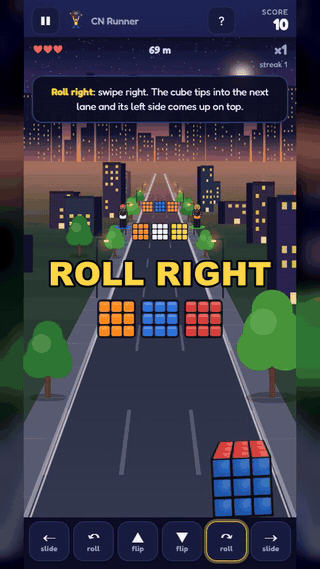
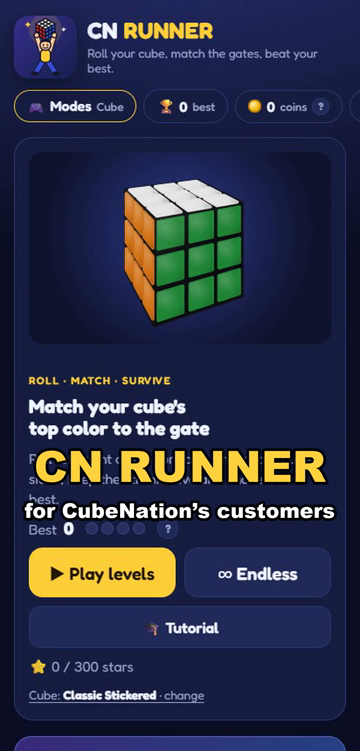
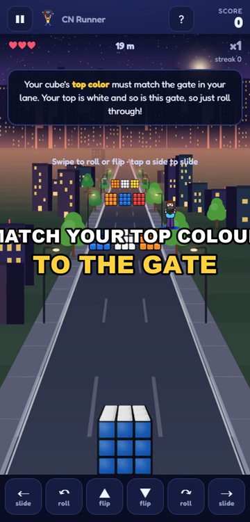
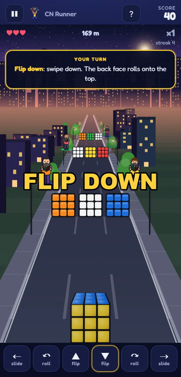

<h1 align="center">CN Runner</h1>

<b>A 3D cube runner game for CubeNation's customers</b> Roll, flip and slide your cube so its top colour matches each gate.

<a href="cn-runner-demo.mp4"><b>▶ Watch the full demo video (38 s)</b></a>

---

## About the project

CN Runner is a mobile game I built for **CubeNation**, an online speed cube and puzzle store in Bangladesh, to give its customers a fun reason to keep coming back to the brand.

**My role:** product owner. I shaped the features, tested every build on phones and PC, and gave the feedback that drove each fix. The code was written with **AI (Claude)**.

## Features

- **10 worlds × 10 levels**, each with 1–3 stars; stars unlock the next world
- **Endless mode** and a **daily challenge**
- **Coins** to unlock 10 cube models
- **Guided tutorial** that teaches every move step by step
- Touch controls on phones, keyboard on PC
- Original music and sound

## Built with

- **Android app:** React Native (Expo) with Skia graphics
- **Web version:** a single protected HTML file for the CubeNation website
- **Tools:** Claude (AI) for code, Git for version control

## Screens

---

© CubeNation. All rights reserved. This page is a showcase; the game's source code is private.

**Sizanul Islam** · [LinkedIn](https://www.linkedin.com/in/sizanulislam/) · sizanul.islam5545@gmail.com
